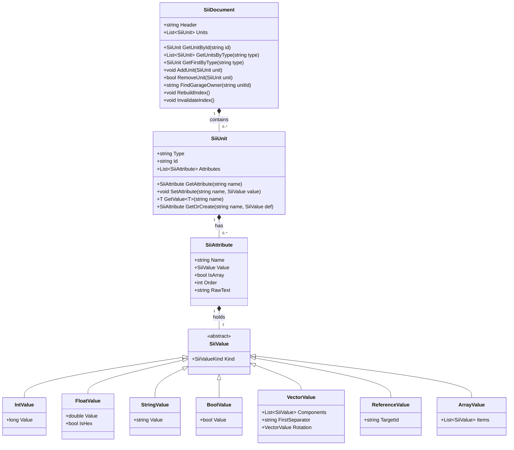
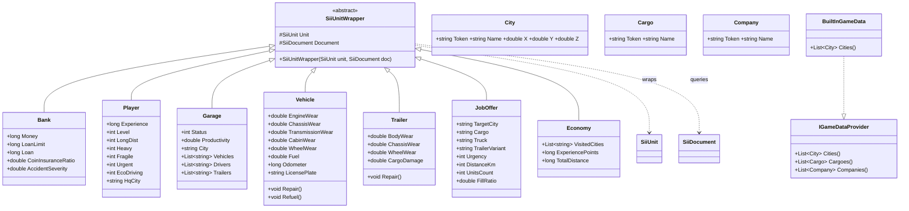
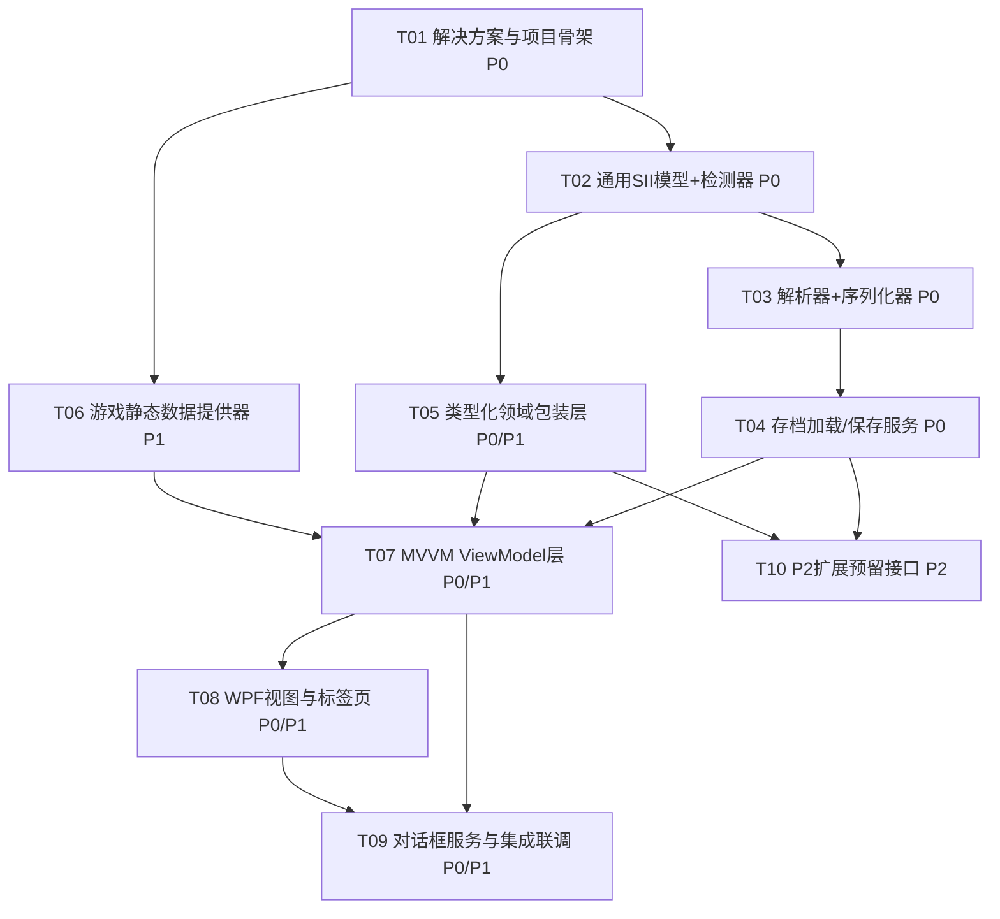

# Ets2SaveEditor 系统架构设计（ARCHITECTURE）

> 文档版本：v0.1（架构草案）　|　作者：架构师 高见远（Gao）　|　状态：待评审
> 适用范围：v1（明文 SII + zlib 压缩 SII；二进制 / 3NK 后置 P2）
> 配套文档：`docs/PRD.md`（产品需求）、`README.md`（技术栈与目录占位）

---

## 1. 实现方案与框架选型

### 1.1 技术栈与理由

| 维度 | 选型 | 理由 |
| --- | --- | --- |
| 语言 / 运行时 | **C# / .NET 8** | LTS 长期支持、跨项目引用简单、原生 `System.IO.Compression.ZLibStream` 可直接做托管 zlib 解压，无需 P/Invoke。 |
| 桌面框架 | **WPF（Windows）** | ETS2 主平台为 Windows；WPF 的 XAML + 数据绑定 + 标签页（TabControl）天然契合 PRD 的多功能页签布局。 |
| 架构模式 | **MVVM（CommunityToolkit.Mvvm）** | 通过 `[ObservableProperty]` / `RelayCommand` / `AsyncRelayCommand` 源码生成器，减少样板代码；视图与逻辑解耦，便于社区贡献与单元测试。 |
| 压缩处理 | **`System.IO.Compression.ZLibStream`** | .NET 原生托管实现，零额外依赖，可安全解压 zlib 变体 SII；加载时解压为明文、保存时写回明文（游戏加载会自动重压缩）。 |
| 分层 | **Core 类库 + WPF 应用** | 解析 / 领域模型 / 游戏数据与 UI 彻底解耦；Core 可被测试、可被后续 CLI / MAUI 复用。 |

### 1.2 核心架构决策：通用模型 + 类型化包装（双层 SII 模型）

为**最大限度避免存档损坏**，采用双层结构：

1. **通用层（无损透传）**：`SiiDocument` / `SiiUnit` / `SiiAttribute` / `SiiValue` 把整个 SII 文件**无损**读入。解析器 / 序列化器对**任何不认识的字段一律原样保留（透传）**，确保即使我们未显式支持某字段也不会丢数据——这是存档安全性的根本保障。
2. **类型化包装层（便捷访问）**：针对已知实体（`Bank` / `Player` / `Garage` / `Vehicle` / `Trailer` / `JobOffer` / `Economy`）提供基于属性名访问的包装类，底层仍操作通用 `SiiUnit`。改金钱 / 等级 / 磨损等**只读写对应字段**，其余结构原样透传。

> 设计不变量：**修改 = 在通用模型上局部 SetAttribute；保存 = 通用模型 → 明文 SII**。绝不直接拼字符串改值，避免破坏语法。

### 1.3 格式检测策略

`SiiFormatDetector` 按首字节判定：
- 以 `SiiNunit` 开头 → 明文（`Plaintext`）。
- 以 `ScsC` 开头 → 加密容器（`Encrypted`）：AES-256-CBC/PKCS7 解密 → zlib 解压 → 载荷再判断。
- 以 `BSII` 开头 → 二进制 SII（`Binary`），交由 `SiiBsiiDecoder` 转换。
- 否则尝试 `ZLibStream` 解压；解压结果以 `SiiNunit` / `BSII` 开头 → `Zlib` 成功。
- 仍失败 → 标注 `Unknown`（抛明确异常，不破坏原文件）。

> **重要（真实存档实证）**：现代 ETS2/ATS 存档为 `ScsC` 容器，容器头 56 字节：
> `[0,4)` 魔数 `ScsC`、`[4,36)` 32 字节 HMAC-SHA256（密钥未公开，**不可复现**）、
> `[36,52)` 16 字节 IV、`[52,56)` 解压后明文长度、`[56,)` AES-256-CBC 密文。
> 解密解压后的载荷是**二进制 `BSII`**，需由 `SiiBsiiDecoder` 转换为 SII 文本。
> 由于 HMAC 无法重新生成，**保存一律写明文 SII**（游戏引擎可直接读取），并在覆盖加密源文件前强制备份。

---

## 2. 文件清单及相对路径

> 仓库根：`Ets2SaveEditor/`。两个项目位于 `src/`。下列文件为 v1 全部需创建的源文件（`.cs` / `.csproj` / `.xaml`）。

### 2.1 解决方案与项目文件

| 相对路径 | 职责 |
| --- | --- |
| `Ets2SaveEditor.sln` | 解决方案，引用下两个项目 |
| `src/Ets2SaveEditor.Core/Ets2SaveEditor.Core.csproj` | .NET 8 类库项目文件（TargetFramework `net8.0`，无额外 NuGet 依赖） |
| `src/Ets2SaveEditor/Ets2SaveEditor.csproj` | .NET 8 WPF 应用项目文件（`<UseWPF>true</UseWPF>`，引用 Core + CommunityToolkit.Mvvm） |

### 2.2 `Ets2SaveEditor.Core`（类库）

| 相对路径 | 职责 |
| --- | --- |
| `src/Ets2SaveEditor.Core/Common/Constants.cs` | 命名空间常量、SII 头字符串 `SiiNunit`、关键 unit 类型名（`bank` / `game` / `garage` / `vehicle` / `trailer` / `job_offer_data` / `economy`）、备份扩展名等共享常量 |
| `src/Ets2SaveEditor.Core/Sii/Model/SiiValue.cs` | 抽象值类型 `SiiValue` 及子类 `IntValue` / `FloatValue`（含 `IsHex` 十六进制浮点标记）/ `StringValue` / `BoolValue` / `VectorValue` / `ReferenceValue` / `ArrayValue`（含 `SiiValueKind` 枚举） |
| `src/Ets2SaveEditor.Core/Sii/Model/SiiValueExtensions.cs` | 值读取辅助扩展：`AsId` / `AsDouble` / `AsLong` / `IsHexFloat` |
| `src/Ets2SaveEditor.Core/Sii/Model/SiiAttribute.cs` | 通用属性（Name / Value / IsArray / Order / RawText 透传原文） |
| `src/Ets2SaveEditor.Core/Sii/Model/SiiUnit.cs` | 通用 unit（Type / Id / 有序 Attributes，Get/Set/GetOrCreate 方法，数组读写辅助） |
| `src/Ets2SaveEditor.Core/Sii/Model/SiiDocument.cs` | 顶层文档（Header / 有序 Units，按 Id / Type 查询）；**带 id / 类型 / 车库归属索引**，查询 O(1)；增删单元走 `AddUnit` / `RemoveUnit` 以同步索引 |
| `src/Ets2SaveEditor.Core/Sii/SiiFormatDetector.cs` | 格式枚举 `SiiFormat`、首字节检测（`ScsC` / `SiiNunit` / `BSII` / zlib）、AES-256-CBC 解密、zlib 解压 |
| `src/Ets2SaveEditor.Core/Sii/SiiBsiiDecoder.cs` | **二进制 `BSII` 解码器**：结构定义块 / 数据块、编码字符串（38 进制）、nameless id（16 位分组）、ORDINAL 查找表、PLACEMENT 偏移还原、IEEE754 十六进制浮点、**无符号类型最大值 → `nil` 哨兵** → SII 文本 |
| `src/Ets2SaveEditor.Core/Sii/SiiParser.cs` | 明文 SII 文本 → `SiiDocument`（逐 unit / 逐 attribute 解析，数组索引、`&hex` 浮点、向量 / placement，未知结构原样保留） |
| `src/Ets2SaveEditor.Core/Sii/SiiSerializer.cs` | `SiiDocument` → 明文 SII 文本（无损写回，格式与游戏自身输出一致） |
| `src/Ets2SaveEditor.Core/Sii/SiiFormatException.cs` | 解析 / 格式相关自定义异常 |
| `src/Ets2SaveEditor.Core/Domain/IUnitCollection.cs` | 类型化访问接口：按 type / id 取 `SiiUnit`，供包装类复用 |
| `src/Ets2SaveEditor.Core/Domain/TypedUnits/Bank.cs` | 类型化包装（`bank`）：`Money`（`money_account`）/ `LoanLimit` / `Loan` / `CoinInsuranceRatio` / `AccidentSeverity` 等 |
| `src/Ets2SaveEditor.Core/Domain/TypedUnits/Player.cs` | 类型化包装（`economy` + `player`）：`Experience`（`experience_points`）/ `Level` / 技能（`LongDist` / `Heavy` / `Fragile` / `Urgent` / `EcoDriving`）/ `HqCity` / `OwnedTrucks` 等 |
| `src/Ets2SaveEditor.Core/Domain/TypedUnits/Garage.cs` | 类型化包装（`garage`）：`Status` / `Productivity` / `City` / `Vehicles` / `Drivers` / `Trailers` 及其数量 |
| `src/Ets2SaveEditor.Core/Domain/TypedUnits/Vehicle.cs` | 类型化包装（`vehicle`）：`EngineWear` / `ChassisWear` / `TransmissionWear` / `CabinWear` / `WheelWear` / `Fuel`（`fuel_relative`）/ `Odometer` / `LicensePlate`；`Repair()` 归零磨损，`Refuel()` 置满 |
| `src/Ets2SaveEditor.Core/Domain/TypedUnits/Trailer.cs` | 类型化包装（`trailer`）：`BodyWear` / `ChassisWear` / `WheelWear` / `CargoDamage` / `CargoMass` / `Definition`；`ModelName` 在缺少 `trailer_def` 单元（DLC 挂车）时降级用定义本身拼名称，绝不留空白；`Repair()` |
| `src/Ets2SaveEditor.Core/Domain/TypedUnits/JobOffer.cs` | 类型化包装（`job_offer_data`）：`TargetCity` / `Cargo` / `Truck` / `TrailerVariant` / `Urgency` / `DistanceKm` / `UnitsCount` / `FillRatio` |
| `src/Ets2SaveEditor.Core/Domain/TypedUnits/Economy.cs` | 类型化包装（`economy`）：`VisitedCities` / `ExperiencePoints` / `TotalDistance` / `TotalFuelLitres` / `Adr` 等 |
| `src/Ets2SaveEditor.Core/Domain/SaveFile.cs` | 聚合单一存档：Path / Format / LoadedFormat / LastBackupPath / Document / IsLoaded；`Load()` / `Save()`（**原子写入**；加密源文件强制备份）；暴露 `GetBank()` / `GetPlayer()` / `GetGarages()` 等类型化入口 |
| `src/Ets2SaveEditor.Core/Persistence/SaveLocationFinder.cs` | 枚举本地（`文档/Euro Truck Simulator 2/...`）与 Steam（`userdata/<uid>/227300/remote/...`）存档路径，返回 `SaveSlot` 列表 |
| `src/Ets2SaveEditor.Core/Persistence/BackupService.cs` | 保存前备份（`Backup(path)`），生成 `.bak.<yyyyMMddHHmmssfff>`（毫秒精度 + 序号后缀，**绝不覆盖已有备份**） |
| `src/Ets2SaveEditor.Core/GameData/GameDataModel.cs` | 静态实体 `City`（**不可变**，全局目录共享安全）/ `Cargo` / `Company` |
| `src/Ets2SaveEditor.Core/GameData/IGameDataProvider.cs` | 游戏数据提供器接口 |
| `src/Ets2SaveEditor.Core/GameData/BuiltInGameData.cs` | 游戏静态数据的统一入口：**直接委托** `CityCatalogue`（334 个中文城市）、`CargoCatalogue.SelectableTokens`（431 个游戏实际在用的货物 token = 定义表 ∪ 费率表 ∪ 存档实测表，去掉游戏自身从不引用的 cargo_obsole.* 旧名）、`GameNames.Company`（138 家货运公司），不再维护第二份手写清单 |

### 2.3 `Ets2SaveEditor`（WPF 应用）

| 相对路径 | 职责 |
| --- | --- |
| `src/Ets2SaveEditor/App.xaml` + `App.xaml.cs` | 应用入口、全局资源与样式 |
| `src/Ets2SaveEditor/MainWindow.xaml` + `MainWindow.xaml.cs` | 主窗口：菜单栏（文件 / 编辑 / 帮助）+ 左侧导航 + 右侧 `TabControl` 标签容器，绑定 `MainViewModel` |
| `src/Ets2SaveEditor/ViewModels/MainViewModel.cs` | 聚合各功能 VM、当前 `SaveFile`、打开 / 保存 / 备份命令 |
| `src/Ets2SaveEditor/ViewModels/ProfileViewModel.cs` | 档案页：路径 / 等级 / 技能 / 金钱（P0-3~P0-5） |
| `src/Ets2SaveEditor/ViewModels/GaragesViewModel.cs` | 车库页：列表 / 购买 / 升级（P0-6） |
| `src/Ets2SaveEditor/ViewModels/TruckViewModel.cs` | 卡车页：修理 / 加油 / 颜色 / 导出导入 / 位置（P0-7, P1-1, P2-1） |
| `src/Ets2SaveEditor/ViewModels/TrailerViewModel.cs` | 挂车页：列表 / 修理 / 颜色（P1-6） |
| `src/Ets2SaveEditor/ViewModels/FreightMarketViewModel.cs` | 货运市场页：自定义任务创建 / 管理（P1-4） |
| `src/Ets2SaveEditor/ViewModels/CargoViewModel.cs` | 货物页：市场浏览 / 编辑 / 已访问城市抓货（P1-2, P1-3, P1-5） |
| `src/Ets2SaveEditor/ViewModels/SettingsViewModel.cs` | 设置页：默认路径 / Steam 探测开关 / 自动备份开关 / 语言 / 关于 |
| `src/Ets2SaveEditor/Views/ProfileView.xaml` + `.xaml.cs` | 档案页视图 |
| `src/Ets2SaveEditor/Views/GaragesView.xaml` + `.xaml.cs` | 车库页视图 |
| `src/Ets2SaveEditor/Views/TruckView.xaml` + `.xaml.cs` | 卡车页视图 |
| `src/Ets2SaveEditor/Views/TrailerView.xaml` + `.xaml.cs` | 挂车页视图 |
| `src/Ets2SaveEditor/Views/FreightMarketView.xaml` + `.xaml.cs` | 货运市场页视图 |
| `src/Ets2SaveEditor/Views/CargoView.xaml` + `.xaml.cs` | 货物页视图 |
| `src/Ets2SaveEditor/Views/SettingsView.xaml` + `.xaml.cs` | 设置页视图 |
| `src/Ets2SaveEditor/Services/DialogService.cs` | 文件打开 / 保存对话框、消息提示、路径选择（`OpenFileDialog` / `SaveFileDialog` / `FolderBrowserDialog`） |
| `src/Ets2SaveEditor/Converters/*.cs` | 必要的 WPF 值转换器（如 bool→可见性、磨损→进度色） |

---

## 3. 数据结构与接口（类图）

### 3.1 通用 SII 模型 + 值类型



### 3.2 解析 / 序列化 / 存档服务

```mermaid
classDiagram
    class SiiFormatDetector {
        <<enum>> SiiFormat { Plaintext, Zlib, Encrypted, Binary, Unknown }
        +SiiFormat Detect(byte[] raw)
        +string Decode(byte[] raw, SiiFormat format)
    }
    class SiiBsiiDecoder {
        +const string Magic
        +string Decode(byte[] binary)
    }
    class SiiParser {
        +SiiDocument Parse(string text)
        -SiiUnit ParseUnit(...)
        -SiiAttribute ParseAttribute(...)
    }
    class SiiSerializer {
        +string Serialize(SiiDocument doc)
    }
    class SaveFile {
        +string Path
        +SiiFormat Format
        +SiiFormat LoadedFormat
        +string LastBackupPath
        +SiiDocument Document
        +bool IsLoaded
        +void Load(string path)
        +void Save(string path, bool backup)
        +Bank GetBank()
        +Player GetPlayer()
        +List~Garage~ GetGarages()
        +List~Vehicle~ GetVehicles()
        +List~Trailer~ GetTrailers()
    }
    class SaveLocationFinder {
        +List~SaveSlot~ FindLocalProfiles()
        +List~SaveSlot~ FindSteamProfiles()
    }
    class BackupService {
        +string Backup(string path, bool enabled)
    }
    class SaveSlot {
        +string ProfileId
        +string SlotName
        +string FullPath
    }
    SaveFile ..> SiiFormatDetector : uses
    SaveFile ..> SiiParser : uses
    SaveFile ..> SiiSerializer : uses
    SaveFile ..> BackupService : uses
    SiiParser ..> SiiDocument : builds
    SiiSerializer ..> SiiDocument : reads
    SaveLocationFinder ..> SaveSlot : returns
```

### 3.3 类型化包装层 + 游戏数据



### 3.4 ViewModel 层（MVVM）


---

## 4. 程序调用流程（时序图）

打开存档 → 探测格式 → 解压(zlib) → 解析为通用模型 → 类型化包装供 UI 编辑 → 序列化回明文 → 写回文件（含备份）。

```mermaid
sequenceDiagram
    autonumber
    actor User
    participant UI as MainWindow/MainViewModel
    participant Finder as SaveLocationFinder
    participant Det as SiiFormatDetector
    participant Parser as SiiParser
    participant Doc as SiiDocument
    participant Wrap as Typed Wrappers(Bank/Player/...)
    participant Ser as SiiSerializer
    participant Backup as BackupService
    participant FS as FileSystem

    User->>UI: 选择存档路径 / 浏览
    UI->>Finder: FindLocalProfiles()/FindSteamProfiles()
    Finder-->>UI: List<SaveSlot>
    User->>UI: 点击"打开"
    UI->>FS: ReadAllBytes(path)
    FS-->>UI: byte[]
    UI->>Det: Detect(byte[])
    alt 明文 SII
        Det-->>UI: SiiFormat.Plaintext
        UI->>UI: text = Encoding.UTF8.GetString(byte[])
    else zlib 压缩
        Det-->>UI: SiiFormat.Zlib
        UI->>Det: DecompressZlib(byte[])
        Det-->>UI: string(明文 SII)
    end
    UI->>Parser: Parse(text)
    Parser->>Doc: new SiiDocument(); AddUnit(...)
    Doc-->>UI: SiiDocument
    UI->>Wrap: new Bank(doc.GetUnitsByType("bank")[0], doc)
    Wrap-->>UI: 类型化对象(其余字段透传)
    UI->>UI: 绑定到 ViewModel 属性(金钱/等级/技能/...)
    User->>UI: 编辑字段并点击"应用/保存"
    UI->>Wrap: SetAttribute(...)/Repair()/Refuel()
    Wrap->>Doc: 修改底层 SiiUnit 属性
    UI->>Ser: Serialize(Doc)
    Ser-->>UI: string(明文 SII 文本)
    UI->>Backup: Backup(originalPath, settings.AutoBackup)
    Backup->>FS: 写入 .bak.<timestamp>
    UI->>FS: WriteAllText(path, serialized)
    FS-->>UI: 保存成功
    UI-->>User: 提示保存成功(游戏加载时自动重压缩)
```

---

## 5. 任务列表（有序、含依赖、按实现顺序）

> 优先级：P0=核心必须，P1=重要，P2=可选增强。工程师应按编号顺序执行；「所属」标注负责项目/主要文件。

| 编号 | 任务名称 | 所属 / 主要文件 | 依赖 | 优先级 |
| --- | --- | --- | --- | --- |
| **T01** | 解决方案与项目骨架 | `Ets2SaveEditor.sln`、`src/Ets2SaveEditor.Core/*.csproj`、`src/Ets2SaveEditor/*.csproj`、`App.xaml`、`MainWindow.xaml`、`Common/Constants.cs` | 无 | P0 |
| **T02** | 通用 SII 模型与格式检测器 | `Sii/Model/*`、`Sii/SiiFormatDetector.cs`、`Sii/SiiFormatException.cs` | T01 | P0 |
| **T03** | SII 解析器与序列化器（无损透传） | `Sii/SiiParser.cs`、`Sii/SiiSerializer.cs` | T02 | P0 |
| **T04** | 存档加载 / 保存服务 | `Domain/SaveFile.cs`、`Persistence/SaveLocationFinder.cs`、`Persistence/BackupService.cs` | T02, T03 | P0 |
| **T05** | 类型化领域包装层 | `Domain/IUnitCollection.cs`、`Domain/TypedUnits/*`（`Bank`/`Player`/`Garage`/`Vehicle`/`Trailer`/`JobOffer`/`Economy`） | T02 | P0/P1 |
| **T06** | 游戏静态数据提供器 | `GameData/GameDataModel.cs`、`GameData/IGameDataProvider.cs`、`GameData/BuiltInGameData.cs` | T01 | P1 |
| **T07** | MVVM ViewModel 层 | `ViewModels/MainViewModel.cs` 及各功能 VM | T04, T05, T06 | P0/P1 |
| **T08** | WPF 视图与标签页 | `Views/*.xaml` + `.xaml.cs`、`MainWindow.xaml` 标签容器 | T07 | P0/P1 |
| **T09** | 对话框服务与集成联调 | `Services/DialogService.cs`、`Converters/*`、`SettingsView` 设置持久化、关于 / 免责声明、整体联调 | T07, T08 | P0/P1 |
| **T10** | P2 扩展预留接口（二进制/3NK、Mod 扫描、分享导入导出框架） | `SiiFormatDetector` 扩展点、`IGameDataProvider` Mod 扩展、分享序列化工具骨架 | T04, T05 | P2 |

### 5.1 任务依赖图



---

## 6. 依赖包列表（NuGet）

| 包 | 版本 | 用途 | 备注 |
| --- | --- | --- | --- |
| `CommunityToolkit.Mvvm` | `^8.2.2` | MVVM 源码生成器（`[ObservableProperty]` / `RelayCommand` / `AsyncRelayCommand`） | WPF 项目引用，Core 不引用 |
| （无） | — | zlib 解压 | 使用 .NET 8 内置 `System.IO.Compression.ZLibStream`，**无需额外 NuGet 包** |
| （无） | — | WPF UI | 使用 .NET 8 SDK 内置 WPF（`Microsoft.NET.Sdk`，`<UseWPF>true</UseWPF>`） |

> 设计原则：Core 项目 **零第三方依赖**，便于复用与测试；所有外部能力均由 BCL 提供。

---

## 7. 共享知识（跨文件约定）

- **命名空间**：Core 采用 `Ets2SaveEditor.Core.{Sii|Domain|Persistence|GameData}`；WPF 采用 `Ets2SaveEditor.{ViewModels|Views|Services|Converters}`。
- **SII 数值规则**：整数统一 `long`（避免大金额溢出）；浮点 / 磨损统一 `double`；向量 `(x, y, z)`、四元数向量 `(w; x, y, z)`、placement `(x, y, z) (w; a, b, c)`；引用为**无引号**的 nameless id。
- **浮点表示（关键）**：游戏自身**从不写十进制小数**，浮点只以两种形式出现：整数值（`0`、`1`）或 IEEE754 单精度位模式（`&3e117d8d`）。解析与序列化都必须遵循该规则，否则游戏无法读回。`FloatValue.IsHex` 记录该标记。
- **nil 哨兵（关键）**：无符号整型的**类型最大值**表示「无值」，游戏写作 `nil`（UINT16→`0xFFFF`、UINT32/UINT32_ALT→`0xFFFFFFFF`、UINT64→`ulong.MaxValue`）。解码器必须还原为 `nil`，否则会出现 `4294967295` 这类游戏不接受的数字。
- **字符串转义**：属性值双引号包裹，内部 `\"`、换行等按 SII 规则转义；序列化时优先使用解析阶段保留的 `RawText` 兜底，确保字节级无损。
- **字符串表示风格**：同一字段可能是裸写引用（`scania_s_2024e`）也可能是带引号字符串（`"sanbuilders.london"`）。写回时用 `SiiUnit.SetScalarPreserveStyle()` 保持原有风格，避免产生无谓的文本差异。
- **透传约定（关键）**：解析器对任意未识别的 unit / attribute / value **原样保留**；类型化包装只读写已知属性，绝不删除或重排未知字段——这是存档不损坏的根本保证。
- **单位约定**：金钱 / 经验使用游戏内原生单位；坐标为米制（与 SII 一致）；磨损范围 0.0（全新）~1.0（报废），修理即写 0、加油即写 `fuel_relative` = 1。
- **等级推导**：`Level` 由 `Experience`（XP）按**游戏自身的权威曲线**推导——阈值表取自游戏安装目录 `def.scs` 的 `xp_level_data.level_xp[]`（增量语义），详见 §8.1；已在真实存档上完成校验。
- **MVVM 约定**：VM 通过 `CommunityToolkit.Mvvm` 生成属性 / 命令；**VM 绝不引用 View**；`SaveFile` 作为唯一可绑定模型源；长耗时操作（加载 / 保存）使用 `AsyncRelayCommand` 并避免阻塞 UI 线程。
- **备份命名**：`<name>.sii.bak.<yyyyMMddHHmmssfff>`；时间戳为**毫秒**精度，重名时自动追加 `-1` / `-2` … 序号，且 `File.Copy(overwrite: false)` **绝不覆盖已有备份**。原始加密存档不可再生（HMAC 密钥未公开），备份是唯一安全网；覆盖 `ScsC` 源文件时**强制备份**，与 `AutoBackup` 开关无关。
- **原子写入**：保存先写同目录临时文件 `<name>.sii.tmp`（写完 flush 到盘），再用 `File.Move(overwrite: true)` 原子替换目标；异常时删除临时文件。目标文件要么是旧的完整内容，要么是新的完整内容，绝不出现半截文件。
- **错误策略**：任何解析 / 解压失败都**抛明确异常、不写入原文件**，UI 给予友好提示，原存档保持只读未动。
- **真实验证只用副本（硬约束）**：**任何**验证程序 —— 人手动点按钮、离屏渲染、截图工具、探针、
  性能基准、UI 回归自动化 —— **都必须指向临时目录里的副本**，绝不能指向
  `Documents\...\profiles\...\save\` 下的真实存档。
  - **为什么**：即使程序本身不调用保存，只要它**加载了真实存档并渲染界面**，就存在触发写入的路径。
    发布 v0.0.11 前后真实存档 `save/1/game.sii` 曾被写成明文 SII（5.6 MB，而 ETS2 原生保存写的是
    加密 `ScsC`），同目录多出 `game.sii.bak.<时间戳>`；触发源排查未能定位。
    **结论是：不能依赖「我知道它不会写」** —— 这次没触发是运气好，不是设计对。
  - **怎么防**：`[nosavepath]` 断言扫描 `src/` / `tests/` / `tools/` 的代码行（排除注释），
    不允许出现「盘符绝对路径 + 真实存档目录特征」的组合；仓库里唯一允许的绝对路径是测试项目的
    **只读基准常量** `RealSavePath`（它只被复制，从不写入），且断言会检查它只被只读使用。
  - **怎么恢复**：真实存档一旦被明文覆盖，只能靠工具自动生成的 `game.sii.bak.<时间戳>` 还原
    （原始加密存档不可再生），还原后**必须逐字节校验哈希**。
  - **自检要求**：任何自动化脚本在运行**前后**都应记录并比对真实存档的哈希（`sha256sum`），
    让「验证没有副作用」是**可证伪的**，而不是靠声明。
- **测试临时目录按进程隔离**：测试临时根目录为 `ets2test_<进程ID>`，避免开发者本地跑、CI 与复核代理
  并行跑时互相覆盖 fixture 文件，导致断言随机失败。

---

## 8. 待明确事项（需在真实存档上校验）

1. **字段名校验（已在真实存档上完成）**：以下属性名均以真实 `game.sii`（`ScsC` + `BSII`）抽样核对通过：
   - 金钱：`bank` unit 的 `money_account`（INT64）。
   - 贷款：`bank` unit 的 `loans`（ID 数组，指向 `bank_loan` unit）；`loan_limit` 为授信额度。
   - 等级 / 经验：**`economy` unit** 的 `experience_points`（UINT32），技能 `long_dist` / `heavy` / `fragile` / `urgent` / `ecodriving` 同在该 unit（0–6）。
     真实存档中该值经游戏自身三处独立印证：`economy.experience_points`、游戏写的 `profile.sii`（`user_profile.cached_experience`）、以及 `save/<槽>/info.sii`（`save_container.info_players_experience`），三者在同一存档上完全一致。
   - 车库：`garage` unit 的 `vehicles` / `drivers` / `trailers`（ID 数组）、`status`（真实存档恒为 3）、`profit_log`、`productivity`。
   - 卡车磨损：`vehicle` unit 的 `engine_wear` / `transmission_wear` / `cabin_wear` / `chassis_wear`（FLOAT，十六进制浮点）+ `wheels_wear`（数组）；剩余油量在 `fuel_relative`。
   - 挂车：`trailer` unit 的 `trailer_definition` / `trailer_body_wear` / `chassis_wear` / `wheels_wear`。
   - 货运：`job_offer_data` unit 的 `target` / `cargo` / `company_truck` / `urgency` / `units_count` / `fill_ratio` / `trailer_place`。
2. **二进制 / 3NK 格式（P2）**：v1 仅明文 + zlib；`SiiFormatDetector` 已预留 `Binary` / `Unknown` 分支，后续接入参考项目 `SII_Decrypt.dll` 的另两种格式解析。
3. **Steam 路径探测方式**：注册表（`HKEY_CURRENT_USER\Software\Valve\Steam` 的 `SteamPath`）vs 常见路径规则；建议「注册表优先 + 手动指定兜底」。
4. **备份策略默认开关与保留数量**：默认是否开启、保留份数、命名规则（见 §7）。
5. **数值边界与校验**：金钱 / 等级 / 技能是否对齐游戏内上限；超限策略（截断 / 警告 / 拒绝）。
6. **Mod 数据来源（P2-5）**：创意工坊订阅目录解析优先级是否高于编队控制包（P2-3），需产品确认。
7. **城市 / 货物 / 公司清单**：已改为直接委托权威数据源（`CityCatalogue` / `GameNames.Cargo` / `GameNames.Company`），不再有第二份手写清单；货物显示名另有本地化兜底表 `GameNames.LocalizedCargo`（locale.scs 的 `cn_*` 键），用来覆盖 `cargo_data` 没收录、但老存档里还留着的 token；同名货物（散装/箱装/罐装）会加上 token 后缀，保证两个不同的货物不会显示成同一个名字；可选清单用 `CargoCatalogue.SelectableTokens`（去掉游戏自身从不引用的旧名 `cargo_obsole.*`）；后续若要支持 Mod 自定义城市 / 货物，再在此之上叠加 Mod 数据源。

### 8.1 等级换算表的数据来源（已从游戏数据文件逆向确认）

游戏**不存等级**，只存累计经验值 `economy.experience_points`，等级需按游戏自己的曲线换算。
该曲线定义在游戏安装目录 `def.scs`（SCS# v2 归档）内的 `xp_level_data : economy.data.xp_levels` 块：

```
xp_level_data : economy.data.xp_levels
{
	level_names[]: "0|@@lvl_name0@@"      # 等级名边界：0/5/10/15/20/25/30/40/50/100
	...
	# experience points to the next level
	level_xp[0]: 200                        # ← 增量语义：从等级 i 升到 i+1 所需 XP，非累计值
	...
	level_xp[29]: 6800
	driver_xp_scale: 2.0
}
```

**关键语义**：`level_xp[i]` 是「从等级 i 升到等级 i+1 所需的 XP **增量**」，不是累计值——这是最容易搞错的地方。

`def.scs` 只显式给出 `level_xp[0..29]`（前 30 级）；30 级之后游戏沿用最后一项 6800。累加到 L100 得
`99,700 + 70 × 6,800 = 575,700`，与公开资料中 100 级（Divine Champion）的门槛**分毫不差**，印证了这一外推规则。

实现位置：`src/Ets2SaveEditor.Core/Domain/TypedUnits/Player.cs`
- `LevelXpIncrements` — 增量表（索引 i = 等级 i→i+1）
- `LevelXpThresholds[L]` — 升到等级 L 所需的累计 XP（L 从 1 到 100 有效，索引 0 仅占位）
- `LevelFromXp(xp)` / `XpForLevel(level)` / `XpToNextLevel(xp)` — 换算与进度

**三重交叉验证**：
1. 增量累加后与公开等级表逐级比对，L1..L17 共 **17/17 精确匹配**（200, 700, 1400, …, 31100）；
2. 累加到 L100 = 575,700，与「Divine Champion」门槛精确相等；
3. 真实存档 `experience_points = 252,508` 推导为 **52 级**，与游戏内显示一致（早期猜测表给出的是 21 级，即用户报告的错误）。

> 注：公开 Wiki 上的**分段**门槛表（L5=3400 / L30=103700 / L50=249700 等）与本游戏实际曲线存在
> 100~14000 XP 的系统性偏差，属于**旧版本数据**，不可采用；其中 L100=575700 恰好与本表一致，
> 反而印证了尾部外推规则。

**版本升级维护**：游戏更新后用 `tools/extract_level_xp.py` 重新提取并同步 `Player.cs` 中的表：

```bash
python tools/extract_level_xp.py "<ETS2 安装目录>/def.scs"
```

脚本会自动解压归档、解析 `level_xp[]`、展开累计门槛表，并跑三项自校验（满级门槛、公开表逐级比对、真实存档实测值），输出「全部校验通过」方可用于更新。

若默认偏移失效（游戏更新后数据挪了位置），加 `--scan` 重新定位：

```bash
python tools/extract_level_xp.py "<ETS2 安装目录>/def.scs" --scan
```

**SCS# v2 归档目录表（TOC）格式**（逆向自 `def.scs` / `base.scs`，两套独立方法交叉验证一致）：

| 位置 | 含义 |
|---|---|
| 文件头 `u32@0x18` | 索引区大小（= header `v[4]`） |
| `filesize - 索引区大小` | 索引区起点（= header `v[7]`） |
| 索引区 | 整段 zlib 压缩；解压后每条 **20 字节** |
| 条目 `+0` | 条目编号 / 标志位 |
| 条目 `+4` | 标志位（**bit28 = 1** 表示该条目数据是 zlib 压缩的） |
| 条目 `+8` | 压缩后大小 |
| 条目 `+12` | 解压后大小（**可能为 0**，表示未记录，不能据此排除条目） |
| 条目 `+16` | 数据偏移（实际偏移 = 该值 **× 16**） |

走目录表定位比全字节扫描快几个数量级：实测 `def.scs`（27 MB）约 2 秒、`base.scs`（**10.5 GB**）约 5 秒，
而全字节扫描 10.5 GB 需要近 2 小时。`def.scs` 里含 `level_xp` 的条目是 **#19194**（数据偏移 2,140,144），
`base.scs` 与 `base_map.scs` 完整扫描后**均未命中** —— 印证 `def.scs` 是唯一的等级表来源。

---

## 9. 架构要点汇报（给主理人）

本方案采用 **.NET 8 + WPF + MVVM**，双项目分层（`Core` 类库 + `WPF` 应用），核心为**通用 SII 模型（无损透传）+ 类型化包装层**双层结构，从根上杜绝存档损坏；zlib 用 .NET 原生 `ZLibStream` 零额外依赖。共规划 **10 个有序任务**（T01 骨架 → T02/T03 模型与解析 → T04 存档服务 → T05 包装层 → T06 游戏数据 → T07/T08/T09 MVVM 与视图联调 → T10 P2 扩展），P0 覆盖加载/保存/金钱/等级/技能/车库/卡车修理加油，P1 覆盖涂装/城市/货运市场，P2 预留二进制/3NK 与 Mod 扫描。所有未识别字段原样保留，确保安全性；待真实存档校验字段名与备份策略。
